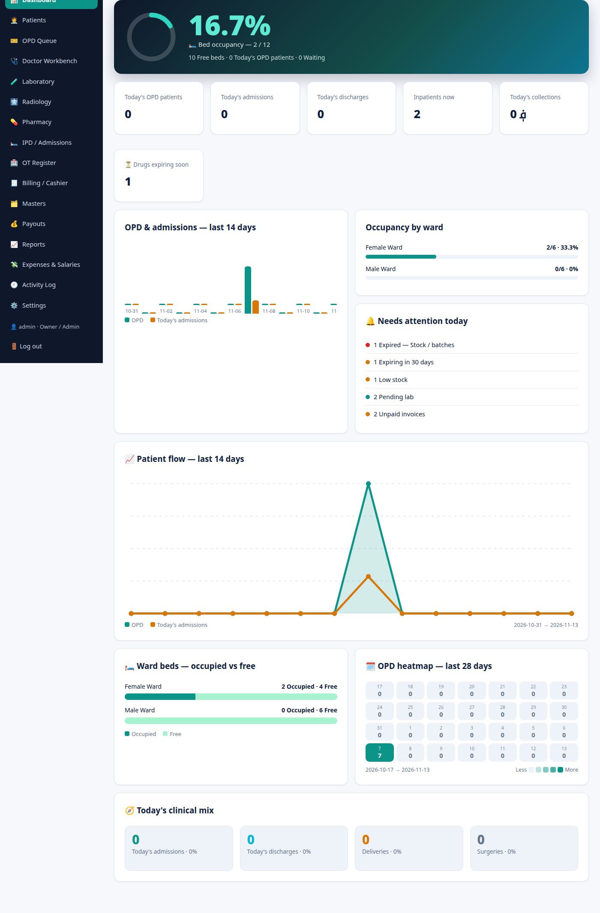

# Hospital PRO — Hospital & Clinic Management System

A complete hospital management system: patients, OPD queue, doctors, laboratory, pharmacy, admissions, billing and an owner dashboard — bilingual (English / Dari), offline-first.

## Key features
- Patient registration with lifetime MRN, duplicate search and printed patient cards
- OPD token queue and one-screen doctor workbench
- Laboratory (LIS-lite) and radiology (RIS-lite) with printed reports
- Pharmacy stock with batch/expiry (FEFO), expired-stock hard block and controlled-medicine register
- Inpatient admissions, bed board, discharge summary and consolidated final invoice
- Billing with gapless receipts, per-cashier shifts, company/insurance credit (khata) and doctor share on collected amounts
- Owner dashboard and daily/monthly reports, role-based access (9 roles), append-only audit log

## Modules
Registration & OPD · Doctor Workbench · Laboratory · Radiology · Pharmacy · IPD & Beds · Billing & Shifts · Khata (credit payers) · Reports & Dashboard · Settings, Backup & Audit

## Tech stack
Python · Django · Django REST Framework | React · Vite · Tailwind CSS | MySQL / SQLite | Flutter / PWA (offline-first)

## About this repository
This is a **showcase repository**. Hospital PRO / Institute PRO / SuperMarket PRO are commercial products of Wakhan Technologies, so the full source code is private. This page documents what the system does and how it is built. Recruiters and clients can request a live demo or a guided code walkthrough — just ask.

- Live portfolio with more screenshots: https://javid-ahmadi-portfolio.vercel.app

## Author
**Ahmad Jawid Ahmadi** — Full Stack Web Developer (React, Django, Flutter), Kabul, working remotely worldwide.
- LinkedIn: https://www.linkedin.com/in/jawid-ahmadi-5a63793ab/
- GitHub: https://github.com/JawidAhmadi77

## Licence
Proprietary — see [LICENSE](LICENSE). Viewing for evaluation only; no copying, deployment or resale.
